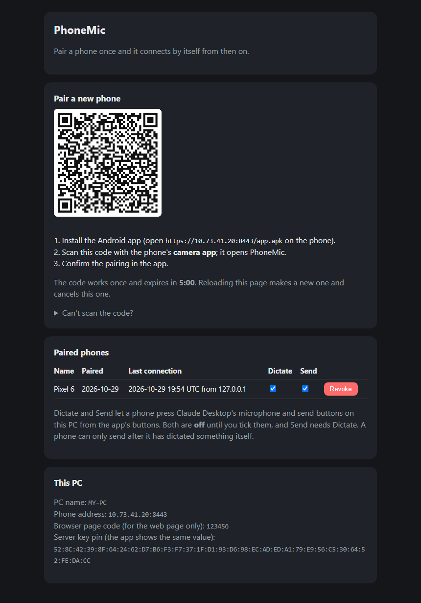
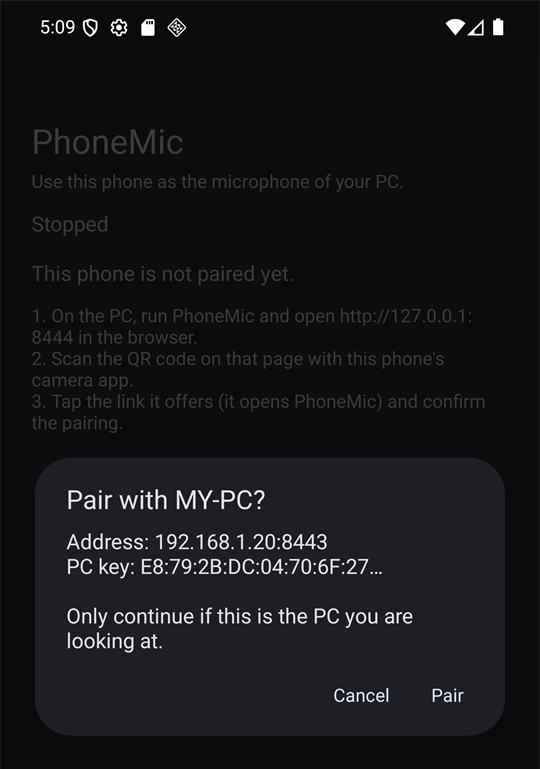
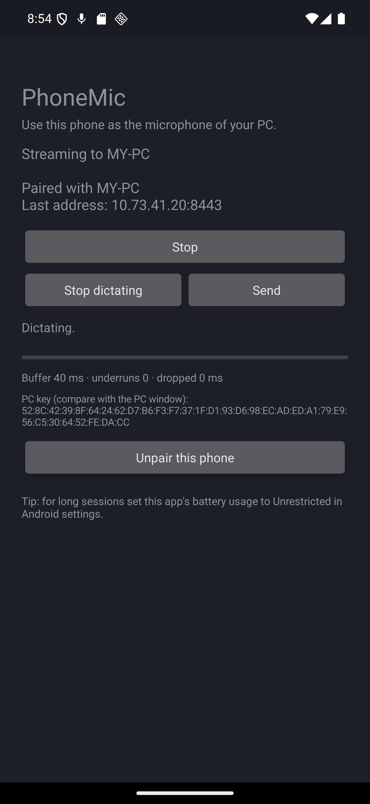

# PhoneMic

Use a phone as the microphone of a Windows PC over the local network. The phone captures its microphone and streams
it to the PC, which plays it into a virtual audio cable. Any app that can record from that cable (for example the
microphone button of Claude Desktop) hears the phone.

```
phone --wss--> PhoneMic server --WASAPI--> "CABLE Input"  ==>  "CABLE Output" (the microphone apps use)
```

Two ways to use it:

- **Android app** (recommended): pair once with a QR code, then it connects by itself, keeps sending with the screen
  off and finds the PC again if its address changes.
- **Web page**: nothing to install; open the PC's address in Chrome and type a 6-digit code. The screen must stay on.

## How it looks

**1. Pair once.** The PC shows a QR code on a page that only your PC can open (<http://127.0.0.1:8444>). The same page
lists the phones already paired, with a button to revoke each one.

<p align="center">
  
</p>

**2. Confirm on the phone, then stream.** Scanning the code with the phone's camera app opens PhoneMic, which asks you
to confirm the pairing (first screenshot). From then on just press **Start** (second screenshot): there is no code to
type, and the app finds the PC again if its address changes.

<p align="center">
  
  &nbsp;&nbsp;
  
</p>

<sub>The screenshots use sample data: a PC called MY-PC at 192.168.1.20 and a phone called Pixel 6.</sub>

## Requirements

- Windows 10/11 and Python 3.13.
- [VB-CABLE](https://vb-audio.com/Cable/) installed (provides "CABLE Input" and "CABLE Output").
- PC and phone on the same Wi-Fi network.

## Setup

```powershell
python -m venv .venv
.\.venv\Scripts\python.exe -m pip install -r requirements.txt
```

Run `run.cmd` (or `python -m phonemic`) to start the server. The first time, allow Python through Windows Firewall on
**private networks**. Then make **CABLE Output** the default recording device (*Settings -> System -> Sound -> Input*).

## Android app

1. With the server running, open `https://<pc-ip>:8443/app.apk` on the phone (accept the certificate warning), download
   the APK and allow installing from that source. It is debug-signed, so Play Protect may ask for confirmation.
2. On the PC, open the pairing page, <http://127.0.0.1:8444> (it opens by itself while no phone is paired).
3. Scan its QR code with the phone's **camera app** and tap the link it offers; PhoneMic opens and asks you to confirm.
   If the camera cannot scan it, the page also shows the link as text to send to the phone.
4. From then on just press **Start**. No code, nothing to retype.

How pairing works:

- The QR code carries a **single-use token that expires in 5 minutes**, the PC's address and the SHA-256 of the PC's
  public key (its "pin"). Reloading the page makes a new code and cancels the old one.
- The app creates a P-256 key pair inside the **Android Keystore** (the private key cannot be exported) and sends only
  the public key. It is stored in `data/devices.json` on the PC.
- Each connection starts with a challenge: the PC sends a random nonce and the phone signs it. No secret travels.
- The app only talks to the server that owns the pinned key. The PC keeps the same key when its certificate is
  re-issued (for example after an address change), so pairing does not expire.
- If the PC's address changes, the app sweeps the Wi-Fi network for the server owning the pinned key (no multicast needed).
- The pairing page lists the paired phones and can **revoke** any of them; a revoked phone is cut off immediately.
- `python -m phonemic --paired` lists the paired phones.

Build the app (JDK 21 from Android Studio, Android SDK 36) from `android/` with `JAVA_HOME` and `ANDROID_HOME` set:
`.\gradlew.bat assembleDebug`. The APK lands in `android/app/build/outputs/apk/debug/app-debug.apk`.

## Remote dictation (Claude Desktop)

With the app streaming, the phone can also press Claude Desktop's **microphone** button and its **Send** button on the
PC, so you can dictate a message and send it without touching the keyboard.

- It is **off for every phone by default**. On the pairing page each paired phone has two checkboxes, **Dictate** and
  **Send**; turning one on or off takes effect at once, even while the phone is connected. Send implies Dictate.
- The phone shows **Dictate** (it becomes **Stop dictating**) and **Send** only for what the PC allows, and a hint
  otherwise.
- Send only works after a dictation made from that phone, and it never types or sends anything by itself: it presses
  the same buttons you would. Presses are rate limited (20 a minute, one at a time) and the PC never logs your text.
- It drives Claude Desktop through Windows UI Automation, with no keyboard shortcut and no screen coordinates. Buttons
  are found by their English names (see `UiNames` in `phonemic/claude_control.py`), so a Claude Desktop update or
  another language may break it. `python -m phonemic --check-claude` shows what PhoneMic can see.
- Tested against a real Claude Desktop for the dictation toggle and the error paths; the final Send press needs an idle
  chat with text in the box, so check it yourself the first time.

## Web page

Open `https://<pc-ip>:8443` in Chrome on the phone, accept the certificate warning (*Advanced* -> *Proceed*), enter the
6-digit code printed by the server (it changes on every start unless you pass `--code`), press **Start** and allow the
microphone. Keep the page open; the screen stays on.

## Options

`--output` (playback device name fragment), `--port`, `--admin-port`, `--host`, `--code`, `--prebuffer-ms`, `--open`
(open the pairing page), `--paired` (also shows each phone's permissions), `--check-claude`, `--list-devices`.

## Security

- Only loopback and private-network (RFC 1918) addresses can connect to the phone-facing port.
- Phones are authenticated by signature (app) or by a 6-digit code with a lockout (web page): five failures lock an
  address out for a minute. Pairing tokens are guarded the same way.
- The pairing page listens on `127.0.0.1` only, rejects unexpected `Host` headers and needs a custom header for
  changing requests, so a website open in your browser cannot drive it.
- Controlling Claude Desktop is opt-in per phone, only works from a paired app (not the web page) and is checked on the PC for
  every press, so revoking a permission or a phone stops it immediately.
- The certificate and key are generated locally in `certs/`, the paired phones live in `data/`; both are ignored by git.

## License

MIT, see [LICENSE](LICENSE). VB-CABLE is a separate product by VB-Audio and is not included in this repository.

## Checks

```powershell
.\.venv\Scripts\python.exe -m unittest discover -s tests -t .
.\.venv\Scripts\python.exe -m scripts.loopback_check   # real audio: tone -> CABLE Input -> CABLE Output
```

Android unit tests: `.\gradlew.bat testDebugUnitTest` from `android/`.
